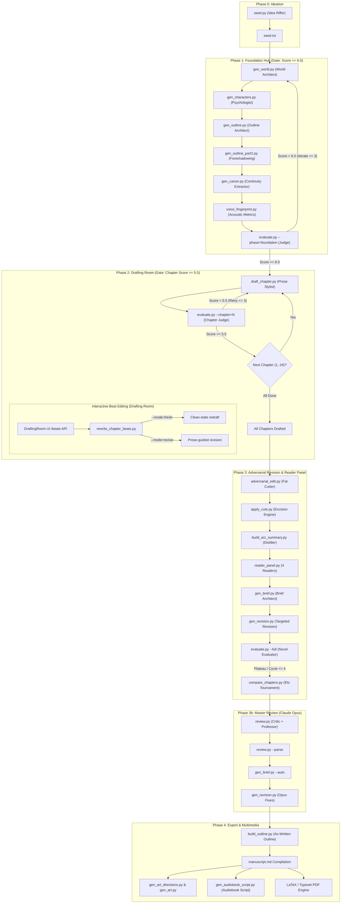

# Comprehensive Agent Catalog & Pipeline Specification

This document provides a complete specification of all AI agents and LLM prompts across the **Autonovel Studio** pipeline. It details each agent's role, system prompts, user prompt templates, input data sources, output formats, and the exact pipeline execution order.

> **Note on Multi-Language Support**: As part of the Arabic support refactor, the literal system and user prompts have been externalized from the Python source code into the `prompts/en/` and `prompts/ar/` directories. The prompts listed in this document reflect the core English specifications. The active templates loaded at runtime depend on the `AUTONOVEL_LANGUAGE` environment variable.

---

## 1. Pipeline Execution Flow & Dependency Architecture

The pipeline consists of four main phases plus specialized revision loops and multimedia export modules.



---

## 2. Global Model Roles & Configurations

All agents interface through [`llm.py`](file:///Users/ahmedelsayegh/Documents/projects/novella-gravity/llm.py), which dispatches to either **Google Gemini** or **Anthropic Claude**:

| Role Function | Default Gemini Model | Default Anthropic Model | Temperature | Max Tokens | Primary Purpose |
| :--- | :--- | :--- | :--- | :--- | :--- |
| `call_writer` | `gemini-2.5-flash` | `claude-sonnet-4-6` | `0.7 - 0.8` | `8,000 - 16,000` | Creative prose, worldbuilding, outlines, character design, script generation |
| `call_judge` | `gemini-2.5-flash` | `claude-sonnet-4-6` | `0.1 - 0.3` | `2,000 - 16,000` | Critical evaluation, structural validation, cut identification, ranking |
| `call_review` | `gemini-2.5-flash` | `claude-opus-4-6` | `0.3` | `8,000` | Deep manuscript-level literary critique and craft feedback |

---

## 3. Detailed Agent Directory

---

### Agent 1: Seed Riffer & Concept Generator
* **Script**: [`seed.py`](file:///Users/ahmedelsayegh/Documents/projects/novella-gravity/seed.py)
* **Caller**: `call_writer(prompt, max_tokens=4000, temperature=1.0)`
* **Application Role**: Ideates high-concept, non-generic novel premises with defined personal/cosmic tensions, magic costs, and thematic questions.
* **Prerequisites / Run Before**: Runs before Phase 1 to produce the fundamental novel premise.

#### Inputs
* Command line arguments (`--count`, `--riff "<concept>"`)

#### Outputs
* Evocative premises written to console or saved into [`seed.txt`](file:///Users/ahmedelsayegh/Documents/projects/novella-gravity/seed.txt).

#### System Prompt
```
You are a fantasy novelist with deep knowledge of the genre's best works -- Tolkien, 
Le Guin, Rothfuss, Wolfe, Jemisin, Peake, Susanna Clarke, Andrew Peterson, Sofia Samatar. 
You generate novel concepts that are SPECIFIC, SURPRISING, and STRUCTURALLY SOUND. 
You never propose generic medieval Europe + elves. Each concept should make a reader 
think 'I've never seen THAT before.'
```

#### User Prompt Template (`GENERATE_PROMPT`)
```
Generate {count} fantasy novel seed concepts. Each should be a complete premise you could build a novel from.

For EACH concept, provide:
NUMBER. TITLE (a working title, evocative, not generic)
HOOK: One sentence that would make someone pick up the book. Specific and surprising, not "In a world where..."
WORLD: What makes this world different? Not just "there's magic" but what specific, unusual thing defines this place? Be concrete -- salt flats, inverted towers, cities that migrate, a sea that remembers, whatever. Make it SENSORY.
MAGIC/COST: What is the core speculative element and what does it COST? Per Sanderson's Second Law, limitations > powers. The cost should create interesting dilemmas.
TENSION: What's the central conflict? It must be both PERSONAL (one character's specific problem) and COSMIC (affects the world). These two must be in tension with each other.
THEME: What question does this story explore? Not a message -- a genuine question with no easy answer.
WHY IT'S NOT GENERIC: One sentence on what makes this different from standard fantasy fare.

Aim for DIVERSITY across the {count} concepts.
DO NOT generate: Chosen one prophecies, Dark lord / ultimate evil, Medieval Europe + elves, "Academy" settings, Love triangles.
```

---

### Agent 2: Worldbuilding Architect
* **Script**: [`gen_world.py`](file:///Users/ahmedelsayegh/Documents/projects/novella-gravity/gen_world.py)
* **Caller**: `call_writer(prompt, system_prompt, max_tokens=16000, temperature=0.7)`
* **Application Role**: Designs the complete physical, social, magical, and historical framework of the novel.
* **Prerequisites**: Requires [`seed.txt`](file:///Users/ahmedelsayegh/Documents/projects/novella-gravity/seed.txt) and optional [`voice.md`](file:///Users/ahmedelsayegh/Documents/projects/novella-gravity/voice.md).
* **Run Before**: Runs before `gen_characters.py`, `gen_outline.py`, and `gen_canon.py`.

#### Inputs
* `seed.txt`: The core novel premise.
* `voice.md`: Tone and stylistic directives.

#### Outputs
* File: [`world.md`](file:///Users/ahmedelsayegh/Documents/projects/novella-gravity/world.md) (comprehensive world bible).

#### System Prompt (Arabic & English)
* **Arabic**:
  ```
  أنت مهندس ومصمم عوالم روائية محترف، تمتلك معرفة عميقة بقوانين بناء العوالم الفانتازية والاجتماعية 
  والتصميم الدرامي عالي الجودة. تصمم أدلة عوالم غنية، مترابطة، وتوحي بعمق تاريخي وثقافي يفوق ما هو مكتوب. 
  تكتب بلغة عربية فصحى أدبية رفيعة، خالية تماماً من الكليشيهات الآلية والترجمات الحرفية. 
  لكل قاعدة ثمن وتكلفة، ولكل تفصيل ثقافي تاريخ، ولكل مكان بصمة حسية وبصرية واضحة.
  ```
* **English**:
  ```
  You are a fantasy worldbuilder with deep knowledge of Sanderson's Laws, Le Guin's prose 
  philosophy, and TTRPG-quality lore design. You write world bibles that are specific, 
  interconnected, and imply depth beyond what's stated. You never use AI slop words. 
  You write in clean, direct prose.
  ```

#### User Prompt Template
* **Arabic**:
  ```
  ابنِ دليلاً شاملاً للعالم الروائي (WORLD.MD) لهذه الرواية باللغة العربية الفصحى الرفيعة.
  هذا المستند هو المرجع الحاكم والنهائي لكل ما هو موجود في هذا العالم.

  فكرة الرواية (البذرة):
  {seed}

  المطلوب بناؤه وتفصيله في دليل العالم:
  1. الجغرافيا والمكان: الحاضرة أو المدينة الرئيسية، خريطة الأحياء والمواقع المحورية، الملمس الحسي لكل مكان (الروائح، الأصوات، العمارة).
  2. النظام الاجتماعي وسلطة النفوذ: الأعراف الحاكمة، موازين القوى، الطبقات الاجتماعية، سيكولوجية العلاقات وقوانين الولاء.
  3. التكلفة الإنسانية والصراعات المجتمعية: ثمن القوة، التوترات بين الأجيال أو الفئات، ونقاط الانفجار المحتملة.
  4. التاريخ والأساطير المؤسسة: أحداث ماضية شكلت واقع الحاضر، أسرار لا يعرفها العامة.
  ```
* **English**:
  ```
  Build a complete world bible for this fantasy novel. This is the WORLD.MD file -- the definitive reference for everything that EXISTS in this world. A writer should be able to resolve any worldbuilding question from this document alone.

  SEED CONCEPT:
  {seed}

  VOICE & TONE:
  {voice}

  Build the complete world bible now. Clean markdown, rich sensory details, hard rules with tangible costs.
  ```

---

### Agent 3: Character Psychologist & Designer
* **Script**: [`gen_characters.py`](file:///Users/ahmedelsayegh/Documents/projects/novella-gravity/gen_characters.py)
* **Caller**: `call_writer(prompt, system_prompt, max_tokens=16000, temperature=0.7)`
* **Application Role**: Creates three-dimensional characters utilizing psychological frameworks (Wound, Want, Need, Lie) and distinctive dialogue cadence.
* **Prerequisites**: Requires `seed.txt` and `world.md`.
* **Run Before**: Runs before `gen_outline.py` and `gen_canon.py`.

#### Inputs
* `seed.txt`, `world.md`, `voice.md`.

#### Outputs
* File: [`characters.md`](file:///Users/ahmedelsayegh/Documents/projects/novella-gravity/characters.md) (complete character registry).

#### System Prompt (Arabic & English)
* **Arabic**:
  ```
  أنت مصمم ومحلل شخصيات روائية من الطراز الرفيع، تمتلك فهماً عميقاً لأبعاد الشخصيات النفسية 
  (الجرح الغائر، الرغبة الظاهرة، الحاجة الباطنة، والقناعة الزائفة)، وتمايز الأصوات الحوارية. 
  تبتكر شخصيات تنبض بالحياة، مليئة بالتناقضات البشرية والأسرار والدوافع الحقيقية. 
  تكتب بلغة عربية فصيحة، رصينة، بعيدة عن القوالب النمطية الجاهزة.
  ```
* **English**:
  ```
  You are a character designer for literary fiction with deep knowledge of wound/want/need/lie 
  frameworks, Sanderson's three sliders, and dialogue distinctiveness. You create characters who 
  feel like real people with contradictions, secrets, and speech patterns you can hear. 
  You never use AI slop words. You write in clean, direct prose.
  ```

#### User Prompt Template (Arabic)
```
ابنِ سجلاً شاملاً وعميقاً للشخصيات (CHARACTERS.MD) لهذه الرواية باللغة العربية الفصحى الرفيعة.
هذا المستند هو المرجع الحاكم لمن هم أبطال الرواية، وما يحركهم، وكيف يتحدثون، وما هي أسرارهم.

المطلوب لكل شخصية رئيسية وثانوية:
1. بطاقة الهوية: الاسم، العمر، الدور السردي، والمظهر الجسدي الحسي (بصمة بصرية مميزة).
2. المحرك النفسي: الجرح القديم (Wound)، الرغبة المعلنة (Want)، الحاجة الروحية (Need)، والقناعة الزائفة (Lie).
3. البصمة الصوتية والحوارية (Dialogue Voice): نبرة الصوت، الكلمات المتكررة، سرعة الكلام، وما الذي تخفيه وراء الكلمات.
4. العلاقات والتوترات: علاقة كل شخصية بالبطل وببقية الشخصيات، وما الذي يربطهم أو يفرقهم.
```

---

### Agent 4: Narrative Architect (Outline Part 1)
* **Script**: [`gen_outline.py`](file:///Users/ahmedelsayegh/Documents/projects/novella-gravity/gen_outline.py)
* **Caller**: `call_writer(prompt, system_prompt, max_tokens=16000, temperature=0.5)`
* **Application Role**: Constructs the 4-act, 24-chapter master plot architecture with specific scene beats, emotional arcs, and POV perspectives.
* **Prerequisites**: `seed.txt`, `world.md`, `characters.md`, `MYSTERY.md`.
* **Run Before**: Runs before `gen_outline_part2.py`.

#### System Prompt (Arabic)
```
أنت مهندس حبكات روائية ومعماري سردي بارع، تمتلك معرفة عميقة بهندسة الفصول وقوانين 
التصاعد الدرامي ونقاط التحول المحورية. تبني مخططات فصول محكمة، دقيقة، بحيث يتمكن 
الكاتب من صياغة كل فصل فوراً دون تردد. لكل فصل هدف سردي واضح، ونبضات محددة، 
وقوس عاطفي متصاعد، وخاتمة مشوقة. تكتب بلغة عربية فصحى أدبية رفيعة.
```

#### User Prompt Structure
```
قسّم الرواية إلى 4 فصول رئيسية (الأعمال الدرامية):
- الفصل التمهيدي (الفصول 1-6): التعريف بالعالم، الصعود، وتوزيع الأدوار وبداية التوتر.
- الفصل التصاعدي الأول (الفصول 7-12): أول بوادر الاستقلال والشرخ، نقطة اللاعودة في المنتصف.
- الفصل التصاعدي الثاني (الفصول 13-18): تصاعد الصراع، خلع الأقنعة، والانهيار الممنهج.
- الفصل الختامي (الفصول 19-24): الذروة الدرامية الكبرى، المواجهة الحاسمة، وحسم المصائر.

لكل فصل من الفصول (من الفصل 1 إلى الفصل 24)، اكتب التالي بدقة متناهية:
# الفصل X: [عنوان الفصل]
- شخصية وجهة النظر (POV): [اسم الشخصية]
- موقع المشهد: [المكان بالتحديد]
- النبضات السردية (Numbered Beats):
  1. [النبضة الأولى: كيف يبدأ المشهد]
  2. [النبضة الثانية: تصاعد الحوار أو الحدث]
  3. [النبضة الثالثة: المفاجأة أو التوتر]
  4. [النبضة الرابعة: القرار أو النتيجة]
- القوس العاطفي والهدف: [التحول الشعوري للشخصية]
- الخاتمة والخطاف: [كيف ينتهي الفصل ويمهّد للتالي]
```

---

### Agent 5: Foreshadowing & Climax Architect (Outline Part 2)
* **Script**: [`gen_outline_part2.py`](file:///Users/ahmedelsayegh/Documents/projects/novella-gravity/gen_outline_part2.py)
* **Caller**: `call_writer(prompt, max_tokens=16000, temperature=0.5)`
* **Application Role**: Extends and finishes later chapters if truncated, and compiles the **Foreshadowing Ledger** mapping plants to payoffs.
* **Prerequisites**: `outline.md` (Part 1).

#### Foreshadowing Ledger Schema Required:
```markdown
## Foreshadowing Ledger
| # | Thread | Planted (Ch) | Reinforced (Ch) | Payoff (Ch) | Type |
Rule: Minimum 15 threads; Plant-to-payoff distance >= 3 chapters.
```

---

### Agent 6: Continuity & Canon Extractor
* **Script**: [`gen_canon.py`](file:///Users/ahmedelsayegh/Documents/projects/novella-gravity/gen_canon.py)
* **Caller**: `call_writer(prompt, system=SYSTEM_PROMPT, max_tokens=16000, temperature=0.2)`
* **Application Role**: Extracts all hard, immutable facts into [`canon.md`](file:///Users/ahmedelsayegh/Documents/projects/novella-gravity/canon.md) to enforce continuity constraints across all writing agents.
* **Prerequisites**: `seed.txt`, `world.md`, `characters.md`.

#### System Prompt
```
You are a continuity editor extracting hard facts from fantasy novel planning documents. 
You are precise, exhaustive, and never invent facts that aren't in the source material. 
Every entry must be traceable to a specific statement in the source documents.
```

#### Output Categories in `canon.md`
- `## Geography`, `## Timeline`, `## Magic System Rules`, `## Character Facts`, `## Political / Factional`, `## Cultural`, `## Established In-Story`.

---

### Agent 7: Foundation Quality Gate Judge
* **Script**: [`evaluate.py --phase=foundation`](file:///Users/ahmedelsayegh/Documents/projects/novella-gravity/evaluate.py)
* **Caller**: `call_judge(prompt, max_tokens=16000, temperature=0.3)`
* **Application Role**: Rigorously audits the foundation documents (`world.md`, `characters.md`, `outline.md`, `canon.md`, `voice.md`) across 13 dimensions.
* **Gate Threshold**: `overall_score >= 6.0`. If it fails, the pipeline repeats Foundation generation up to 3 iterations.

#### Output JSON Schema
```json
{
  "magic_system": {"score": 0.0, "gap": "...", "fix": "..."},
  "world_history": {"score": 0.0, "gap": "...", "fix": "..."},
  "geography_and_culture": {"score": 0.0, "gap": "...", "fix": "..."},
  "lore_interconnection": {"score": 0.0, "gap": "...", "fix": "..."},
  "iceberg_depth": {"score": 0.0, "gap": "...", "fix": "..."},
  "character_depth": {"score": 0.0, "gap": "...", "fix": "..."},
  "character_distinctiveness": {"score": 0.0, "gap": "...", "fix": "..."},
  "character_secrets": {"score": 0.0, "gap": "...", "fix": "..."},
  "outline_completeness": {"score": 0.0, "gap": "...", "fix": "..."},
  "foreshadowing_balance": {"score": 0.0, "gap": "...", "fix": "..."},
  "internal_consistency": {"score": 0.0, "gap": "...", "fix": "..."},
  "voice_clarity": {"score": 0.0, "gap": "...", "fix": "..."},
  "canon_coverage": {"score": 0.0, "gap": "...", "fix": "..."},
  "overall_score": 0.0,
  "lore_score": 0.0
}
```

---

### Agent 8: Chapter Prose Stylist & Draft Writer
* **Script**: [`draft_chapter.py`](file:///Users/ahmedelsayegh/Documents/projects/novella-gravity/draft_chapter.py)
* **Caller**: `call_writer(prompt, system_prompt=system_prompt, max_tokens=8000, temperature=0.8)`
* **Application Role**: Drafts complete novel chapters (2,000–3,500 words) sequentially, grounded by outline beats and voice rules.
* **Prerequisites**: Foundation files (`seed.txt`, `outline.md`, `world.md`, `characters.md`, `canon.md`, `voice.md`), and the tail of Chapter $N-1$.
* **Run Before**: Runs before `evaluate.py --chapter=N`.

#### Context Inputs Given to Model
1. Foundation premise & world bible excerpt.
2. Character dossiers of characters present in this chapter.
3. Canon continuity constraints.
4. **Current Chapter Beats** extracted from `outline.md`.
5. **Next Chapter Outline** (for smooth narrative bridges).
6. **Previous Chapter Tail** (last 2,000 characters of Chapter $N-1$ for immediate voice/rhythm pickup).

#### System Prompt (Arabic & English)
* **Arabic Core Principles**:
  - Show, Don't Tell; sensory immersion (smells, textures, lighting).
  - Dialogue with subtext and tension (what is withheld > what is spoken).
  - Prohibition of automated AI phrases ("في النهاية", "وجد نفسه أمام", "تنهد بعمق").
* **English Core Principles**:
  - Sensory detail first, no abstract summaries.
  - Sentence length variance (short punching sentences mixed with cadence).
  - Anti-slop rules from `ANTI-SLOP.md`.

#### Output
* File: `chapters/ch_{num:02d}.md`.

---

### Agent 9: Chapter Evaluator & Mechanical Slop Judge
* **Script**: [`evaluate.py --chapter=N`](file:///Users/ahmedelsayegh/Documents/projects/novella-gravity/evaluate.py)
* **Caller**: `call_judge(prompt, max_tokens=8000, temperature=0.3)`
* **Application Role**: Evaluates an individual chapter draft against the outline beats and character registry. Applies a mathematical penalty for detected AI slop phrases.
* **Gate Threshold**: `score >= 5.5`. (Max 3 attempts per chapter before best-effort fallback).

#### Output Schema
```json
{
  "voice_consistency": {"score": 7, "note": "..."},
  "character_behavior": {"score": 6, "note": "..."},
  "beat_accuracy": {"score": 8, "note": "..."},
  "sensory_richness": {"score": 7, "note": "..."},
  "pacing": {"score": 6, "note": "..."},
  "dialogue_quality": {"score": 7, "note": "..."},
  "weakest_moment": "quote exact weak sentence",
  "strongest_moment": "quote exact best sentence",
  "overall_score": 6.8
}
```

---

### Agent 10: Chapter Beat Rewriter (Drafting Room Dual Modes)
* **Script**: [`rewrite_chapter_beats.py`](file:///Users/ahmedelsayegh/Documents/projects/novella-gravity/rewrite_chapter_beats.py)
* **Caller**: `call_writer(prompt, system_prompt, max_tokens=16000, temperature=0.75)`
* **Application Role**: Executes on-demand rewrites after the author modifies chapter beats in the Drafting Room UI.

#### Operational Modes & Inputs
| Mode | Input Context Provided | Operational Directive |
| :--- | :--- | :--- |
| **`--mode=fresh`** (Re-Draft from Beats) | New beats + `prev_tail` + `next_outline` + Foundation docs. (Existing prose is **excluded**). | Clean-slate drafting. Prevents narrative contamination or zombie scenes from the discarded outline. |
| **`--mode=revise`** (Revise Draft with Beats) | Existing chapter draft + New beats + `prev_tail` + `next_outline` + Foundation docs. | Guided surgical revision. Preserves strong dialogue and sensory descriptions while adapting conflicting scenes to the new beats. |

#### Safety Feature
* Automatically archives the pre-existing draft to `chapters_backup/ch_{ch:02d}_{timestamp}.md`.

---

### Agent 11: Adversarial Editor & Fat Cutter
* **Script**: [`adversarial_edit.py`](file:///Users/ahmedelsayegh/Documents/projects/novella-gravity/adversarial_edit.py)
* **Caller**: `call_judge(prompt, max_tokens=8000, temperature=0.3)`
* **Application Role**: Ruthlessly identifies 10–20 passages per chapter that are bloated, redundant, or over-explaining.
* **Run Before**: Runs at the start of Phase 3 Revision.

#### System Prompt
```
You are a ruthless literary editor. You cut fat from prose. You have no sentiment about 
good-enough sentences -- if a sentence isn't earning its place, it goes. You quote exactly 
from the text. You never invent or paraphrase. Always respond with valid JSON.
```

#### Cut Taxonomies Identified
- `FAT`: Adds nothing, removable with zero loss.
- `REDUNDANT`: Restates what another sentence/scene already demonstrated.
- `OVER-EXPLAIN`: Narrator explaining what the scene already showed.
- `GENERIC`: Could appear in any generic book, ungrounded in this world.
- `TELL`: Names an emotion or internal state instead of showing it.
- `STRUCTURAL`: Disrupts pacing or narrative rhythm.

#### Output
* Log: `edit_logs/ch{num:02d}_cuts.json`.

---

### Agent 12: Arc Summary Distiller
* **Script**: [`build_arc_summary.py`](file:///Users/ahmedelsayegh/Documents/projects/novella-gravity/build_arc_summary.py)
* **Caller**: `call_writer(prompt, max_tokens=250, temperature=0.2)`
* **Application Role**: Condenses each chapter into 3 precise sentences (event, shift, open question) along with opening, closing, and key dialogue excerpts.
* **Output**: Assembles [`arc_summary.md`](file:///Users/ahmedelsayegh/Documents/projects/novella-gravity/arc_summary.md) allowing the 4-Reader Panel to evaluate the entire book without blowing context limits.

---

### Agent 13: 4-Persona Reader Panel
* **Script**: [`reader_panel.py`](file:///Users/ahmedelsayegh/Documents/projects/novella-gravity/reader_panel.py)
* **Caller**: `call_judge(prompt, system=reader["system"], max_tokens=4000, temperature=0.4)`
* **Application Role**: Simulates 4 distinct reader archetypes evaluating the novel's macro narrative arc.
* **Run Before**: Runs before `gen_brief.py`.

#### Reader Personas
1. **The Senior Editor** (`editor`): Focuses on prose texture, subtext, consistency, and whether style is earned.
2. **The Genre Reader** (`genre_reader`): Focuses on momentum, suspense, worldbuilding payoffs, and page-turning drive.
3. **The Novelist / Craftsperson** (`writer`): Focuses on three-act structure, technique visibility, and character arcs.
4. **The General Public Reader** (`first_reader`): Evaluates emotional resonance, confusion, and raw reading enjoyment.

#### Diagnostic Questions Answered by Each Reader
`momentum_loss`, `earned_ending`, `cut_candidate`, `missing_scene`, `thinnest_character`, `best_scene`, `worst_scene`, `would_recommend`, `haunts_you`, `next_book`.

#### Output
* Log: `edit_logs/reader_panel.json` (calculates consensus items where multiple readers flag the same chapter).

---

### Agent 14: Editorial Revision Brief Architect
* **Script**: [`gen_brief.py`](file:///Users/ahmedelsayegh/Documents/projects/novella-gravity/gen_brief.py)
* **Application Role**: Synthesizes critique from reader panel consensus, evaluation logs, or adversarial cuts into an actionable, chapter-specific revision brief.
* **Output**: `briefs/ch{num:02d}_cycle{N}_{issue}.md`.
* **Brief Schema**:
  - `## THE PROBLEM`: Root diagnostic analysis.
  - `## WHAT TO KEEP`: Key moments and voice texture to protect.
  - `## WHAT TO CHANGE`: Explicit scene-by-scene adjustments and cuts.

---

### Agent 15: Targeted Chapter Revision Agent
* **Script**: [`gen_revision.py`](file:///Users/ahmedelsayegh/Documents/projects/novella-gravity/gen_revision.py)
* **Caller**: `call_writer(prompt, system_prompt, max_tokens=16000, temperature=0.75)`
* **Application Role**: Executes revisions on targeted chapters guided strictly by an editorial brief.
* **Inputs**: Existing chapter draft + revision brief + adjacent chapter tail/head + world/characters/voice.
* **Output**: Revised `chapters/ch_{num:02d}.md`. Verified against previous score; if score regresses, git automatically reverts to `HEAD`.

---

### Agent 16: Elo Pairwise Tournament Judge
* **Script**: [`compare_chapters.py`](file:///Users/ahmedelsayegh/Documents/projects/novella-gravity/compare_chapters.py)
* **Caller**: `call_judge(prompt, system=SYSTEM_PROMPT, max_tokens=4000, temperature=0.2)`
* **Application Role**: Runs head-to-head Swiss tournaments between chapter pairs to establish a true relative quality ranking.
* **Rule**: Strict binary choice — ties are strictly forbidden. Must quote decisive sentences from winner and loser.

---

### Agent 17: Master Reviewer (Claude Opus / Deep Reviewer)
* **Script**: [`review.py`](file:///Users/ahmedelsayegh/Documents/projects/novella-gravity/review.py)
* **Caller**: `call_review(prompt, max_tokens=8000, temperature=0.3)`
* **Application Role**: Holistic review of the entire concatenated novel manuscript (`manuscript.md`).

#### Dual Personas
1. **The Literary Critic**: Newspaper-style review assessing cultural and aesthetic merit, awarding a star rating (1–5 stars).
2. **The Fiction Professor**: Actionable, numbered diagnostic workshop notes classified into:
   - Severity: `major`, `moderate`, `minor`.
   - Fix Type: `compression`, `expansion`, `reorder`, `voice`.

#### Output
* File: `edit_logs/{timestamp}_review.json` and human-readable `reviews.md`.

---

### Agent 18: As-Written Outline Reconstructer
* **Script**: [`build_outline.py`](file:///Users/ahmedelsayegh/Documents/projects/novella-gravity/build_outline.py)
* **Caller**: `call_judge(prompt, max_tokens=1500, temperature=0.1)`
* **Application Role**: Reads all 24 drafted and revised chapters, extracting the actual scene beats, try-fail cycles, and planted/harvested threads to rebuild an accurate, as-written `outline.md`.

---

### Agent 19: Art Director & Visual Concept Designer
* **Script**: [`gen_art_directions.py`](file:///Users/ahmedelsayegh/Documents/projects/novella-gravity/gen_art_directions.py) & [`gen_art.py`](file:///Users/ahmedelsayegh/Documents/projects/novella-gravity/gen_art.py)
* **Caller**: `call_writer(prompt, max_tokens=3000, temperature=0.9)`
* **Application Role**: Generates radically divergent visual concepts across art styles (oil, linocut, watercolor, typographic) for:
  - Novel Book Covers.
  - Chapter Header Ornaments.
  - World Cartography Maps.
  - Scene Break Dividers.

---

### Agent 20: Audiobook Dramatist & Script Voice Tagger
* **Script**: [`gen_audiobook_script.py`](file:///Users/ahmedelsayegh/Documents/projects/novella-gravity/gen_audiobook_script.py)
* **Caller**: `call_writer(prompt, max_tokens=8000, temperature=0.1)`
* **Application Role**: Parses prose chapters into multi-cast audio scripts with character attributions and **ElevenLabs v3 emotional audio tags** (`[whisper]`, `[tense]`, `[softly]`, `[pause]`, `[firmly]`).
* **Output**: `audiobook/scripts/ch{num:02d}_script.json`.

---

## 4. Pipeline Execution Order Matrix

| Sequence | Phase | Script / Agent | Gating / Stopping Condition |
| :---: | :--- | :--- | :--- |
| **1** | Phase 0 | `seed.py` | Selected concept saved to `seed.txt` |
| **2** | Phase 1 | `gen_world.py` | `world.md` created |
| **3** | Phase 1 | `gen_characters.py` | `characters.md` created |
| **4** | Phase 1 | `gen_outline.py` + `gen_outline_part2.py` | `outline.md` created (24 chapters + ledger) |
| **5** | Phase 1 | `gen_canon.py` | `canon.md` created |
| **6** | Phase 1 | `voice_fingerprint.py` | Quantitative metrics calculated |
| **7** | Phase 1 | `evaluate.py --phase=foundation` | **Score $\ge 6.0$** (Loops $\le 3$ iterations) |
| **8** | Phase 2 | `draft_chapter.py {ch}` | `chapters/ch_{ch}.md` generated |
| **9** | Phase 2 | `evaluate.py --chapter={ch}` | **Score $\ge 5.5$** (Retries $\le 3$ attempts/ch) |
| **10** | Phase 2 (Ad-hoc) | `rewrite_chapter_beats.py {ch}` | User updates beats in UI; fresh or revise run |
| **11** | Phase 3 | `adversarial_edit.py all` | Extracts cuts to `edit_logs/ch*_cuts.json` |
| **12** | Phase 3 | `apply_cuts.py all` | Removes fat & redundant prose |
| **13** | Phase 3 | `build_arc_summary.py` | Rebuilds `arc_summary.md` |
| **14** | Phase 3 | `reader_panel.py` | 4 readers produce `reader_panel.json` |
| **15** | Phase 3 | `gen_brief.py` + `gen_revision.py` | Revises weakest chapters from consensus |
| **16** | Phase 3 | `evaluate.py --full` | Novel score logged; stops if delta $< 0.3$ |
| **17** | Phase 3b | `review.py` (Claude Opus) | Stops if $\ge 4\star$ and 0 major defects |
| **18** | Phase 4 | `build_outline.py` | As-written outline generated |
| **19** | Phase 4 | Manuscript Concatenation | Compiles all chapters into `manuscript.md` |
| **20** | Phase 4 | `gen_art.py` & `gen_audiobook_script.py` | Art generation and multi-voice audio scripts |
| **21** | Phase 4 | LaTeX / XeLaTeX PDF | Final book publication PDF |
