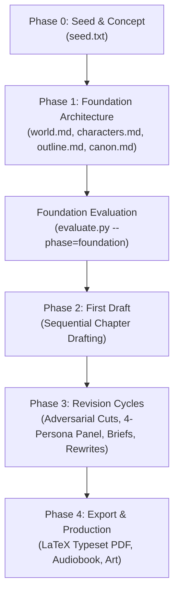

# Autonovel Studio — Complete User Manual & Pipeline Guide

Welcome to **Autonovel Studio**, an autonomous AI-driven novel writing environment powered by Google Gemini (and Claude). This manual details every phase of the pipeline, from premise generation to finished manuscript typesetting.

---

## 🚀 Quick Start

### 1. Configure Your API Key
Ensure your `.env` file in the project root contains your `GEMINI_API_KEY`:
```env
GEMINI_API_KEY=AIzaSyYourActualKeyHere
AUTONOVEL_WRITER_MODEL=gemini-2.5-pro
AUTONOVEL_JUDGE_MODEL=gemini-2.5-pro
AUTONOVEL_REVIEW_MODEL=gemini-2.5-pro
```

### 2. Launch the Studio UI
Start the local server with one command:
```bash
./start_studio.sh
# Or: python3 server.py
```
Open your browser at **`http://127.0.0.1:8000`**.

### 3. Multilingual Support (English & العربية)
* Click the **🌐 Language Button** in the top bar to toggle between **English** and **العربية (RTL)**.
* In Arabic mode, the studio automatically switches to Right-to-Left (RTL) orientation with Arabic typography (*Cairo*, *Amiri*, and *IBM Plex Sans Arabic*).


---

## 📖 Step-by-Step Writing Workflow



---

### Step 1: Seed & Concept Studio (Phase 0)

1. Navigate to the **Seed & Concept** tab in the UI (or open [`seed.txt`](file:///Users/ahmedelsayegh/Documents/projects/novella-gravity/seed.txt)).
2. **Generate New Premises**: Use the *AI Idea Riffing* panel to generate distinct concepts with strict magic rules, personal tensions, and world hooks.
3. Save your favorite concept to `seed.txt`.

**CLI Equivalent:**
```bash
python3 seed.py --count 5
# Or riff on a specific idea:
python3 seed.py --riff "A clockmaker whose time magic costs memories"
```

---

### Step 2: Foundation & Worldbuilding Hub (Phase 1)

Before writing prose, the pipeline generates 4 core architectural documents:
1. **World Bible (`world.md`)**: Geography, cosmology, magic system rules (Sanderson's Laws), and societal tensions.
2. **Character Registry (`characters.md`)**: Sanderson's 3-Sliders (Proactivity, Likability, Competence), Wound/Want/Need/Lie chains, and distinct dialogue voice guidelines.
3. **Chapter Outline (`outline.md`)**: Full 24-chapter breakdown with Save the Cat beats, emotional arcs, try-fail cycles, and a 15+ thread Foreshadowing Ledger.
4. **Hard Canon Database (`canon.md`)**: Extracted unalterable facts to prevent hallucinations and continuity errors.

**In the UI:**
* Open the **Foundation & World** tab and click the **"Run gen_world.py"**, **"Run gen_characters.py"**, and **"Run gen_outline.py"** action buttons.
* Click **"Score Foundation"** to run automated craft checks.

**CLI Equivalent:**
```bash
python3 gen_world.py > world.md
python3 gen_characters.py > characters.md
python3 gen_outline.py > outline.md
python3 gen_canon.py > canon.md
python3 evaluate.py --phase=foundation
```

---

### Step 3: Drafting Room (Phase 2)

Sequential chapter generation enforces strict narrative continuity:
* Each chapter draft automatically reads the previous chapter's ending and the next chapter's opening.
* Banned "AI slop" vocabulary (e.g., *tapestry*, *delve*, *myriad*, *chuckle*) and formulaic narration (*"He did not X, but Y"*) are actively suppressed and penalized.

**In the UI:**
* Open the **Drafting Room** tab.
* Select any chapter from the sidebar and click **"Draft Ch X"** or **"Score Ch X"**.
* Read and edit prose in the distraction-free literary reader.

**CLI Equivalent:**
```bash
# Draft a specific chapter:
python3 draft_chapter.py 1

# Score and inspect AI-pattern violations:
python3 evaluate.py --chapter=1
```

---

### Step 4: Editorial & Revision Lab (Phase 3)

The revision phase subjects the manuscript to multi-layered editorial pressure:
1. **Adversarial Cuts (`adversarial_edit.py`)**: The model is tasked with ruthlessly identifying ~500 words of fat per chapter (`OVER-EXPLAIN`, `REDUNDANT`, `SLOP`, `TELLING`).
2. **Elo Tournament (`compare_chapters.py`)**: Head-to-head chapter match-ups generate a true literary quality leaderboard.
3. **4-Persona Reader Panel (`reader_panel.py`)**: Gathers holistic arc critique from *The Editor*, *The Genre Reader*, *The Literary Writer*, and *The First Reader*.
4. **Targeted Revision Briefs & Rewrites (`gen_brief.py` & `gen_revision.py`)**: Auto-generates revision briefs for the weakest chapters and rewrites them.
5. **Full Manuscript Review (`review.py`)**: Dual-persona full review (Literary Critic + Fiction Professor) providing star ratings and line-by-line craft recommendations.

**In the UI:**
* Open the **Editorial & Revision** tab to explore the visual cut cards, tournament standings, reader panel debates, and manuscript star reviews.

**CLI Equivalent:**
```bash
# Run 500-word adversarial cuts across all chapters:
python3 adversarial_edit.py all

# Build arc summary and run 4-reader panel:
python3 build_arc_summary.py
python3 reader_panel.py

# Run deep full-manuscript review:
python3 review.py
```

---

### Step 5: Export & Production (Phase 4)

Once revision reaches the target score (typically $\ge 8.0$), the novel is compiled:
* **LaTeX Book & PDF**: Formatted with serif typography and drop caps via `typeset/build_tex.py`.
* **Art & Covers**: Generates diverse art direction prompts and covers via `gen_art_directions.py` and `gen_art.py`.
* **Audiobook Production**: Parses chapters into character-attributed script segments with emotion delivery tags via `gen_audiobook_script.py`.

---

## 🤖 Running the Master Orchestrator

To run the entire pipeline autonomously from start to finish:

```bash
# Start fresh from seed.txt:
python3 run_pipeline.py --from-scratch

# Run only a specific phase:
python3 run_pipeline.py --phase drafting
python3 run_pipeline.py --phase revision --max-cycles 4
```

In the Web UI, click the **"Run Pipeline"** button in the top navigation bar at any time to open the master orchestrator launcher.

---

## 🔄 How to Reset & Start a New Novel

When you want to start a brand-new book from a fresh concept:

### Option A: Via the Web UI (One Click)
1. In the top navigation bar, click the **"New Novel / Reset"** button.
2. A confirmation modal will appear. Your existing novel, drafts, and evaluation logs are **automatically archived** to `archive/novel_[timestamp]/`.
3. Check **"Keep current seed.txt"** if you want to keep your premise, or leave it unchecked to start with a blank starter template.
4. Click **"Archive & Reset"**.
5. The studio returns to Phase 1 (Foundation) with 0 chapters. Enter your new premise in the **Seed Studio** and begin!

### Option B: Via the Terminal CLI
Run the dedicated reset script:
```bash
# Safely archive current drafts to archive/ and reset state to Foundation:
python3 reset_project.py

# Keep your current seed.txt premise while clearing chapters & logs:
python3 reset_project.py --keep-seed

# Start the full pipeline immediately from scratch:
python3 run_pipeline.py --from-scratch
```

---

## 🚀 Advanced Studio Features & Capabilities

### 1. Interactive Cut Applicator & Revision Briefs Hub (Phase 3)
- **Interactive Adversarial Cuts**: Browse fat-elimination targets extracted by the judge model. Selectively check off quotes and click **"Apply Selected Cuts to Chapter"** to excise repetitive prose and tighten narrative density.
- **Revision Briefs & Chapter Rewriting**:
  - Generate structured revision briefs (`briefs/ch_XX_brief.md`) combining reader panel critiques and adversarial cuts.
  - Edit revision instructions in the live editor and save changes.
  - Click **"Rewrite Chapter from Brief"** (`gen_revision.py`) to execute a full rewrite with strict voice continuity.

### 2. Novel Convergence Analytics & Quality Heatmap
- Access via the **"Quality Analytics" (تحليلات الجودة والتطور)** sidebar tab.
- **Per-Chapter Quality Matrix**: Live cards displaying word counts, reading times, evaluation scores, fat percentages, and Elo tournament ratings.
- **Convergence History**: Visual trajectory tracking scores across Git commit iterations from `results.tsv`.

### 3. Voice Fingerprint Studio (Phase 1)
- Located in the **Foundation & World Hub** under `voice.md`.
- Computes sentence length variance (CV), dialogue ratio, rhythm, and sensory vocabulary wells (Body / Sensory / Trade).
- **Custom Sample Analyzer**: Paste reference prose or excerpts to extract and inspect quantitative voice metrics.

### 4. Engine Settings & Model Switcher (⚙️ Topbar)
- Click **"Engine Settings" (إعدادات المحرك)** in the topbar to configure:
  - **Writer Model**: Switch between `gemini-2.5-pro` (deep literary reasoning) and `gemini-2.5-flash` (ultra-fast drafting).
  - **Judge Model**: Select evaluation and adversarial cut model.
  - **Creativity Temperature**: Interactive slider (0.1 to 1.0) with real-time feedback.
  - **Target Chapter Length**: Select 2,500w, 3,500w, or 5,000w.
  - **Language Mode**: Toggle between Arabic Literary and English Fiction.

---

## 🛠️ Troubleshooting & Tips

| Issue | Cause | Solution |
| :--- | :--- | :--- |
| **"Stuck in revision"** | `state.json` had a stale phase set without chapters on disk. | The pipeline now auto-reconciles on startup. Run with `--from-scratch` or trigger drafting. |
| **"Operation not permitted"** | Sandboxed server with network disabled. | Launch `server.py` or `./start_studio.sh` with network permissions enabled. |
| **"arc_summary.md not found"** | Running `reader_panel.py` before chapters were summarized. | `reader_panel.py` now automatically invokes `build_arc_summary.py` if missing. |
| **Rate Limits (429)** | High token throughput on Gemini Pro. | `llm.py` includes built-in retries. You can customize `AUTONOVEL_WRITER_MODEL=gemini-2.5-flash` in `.env` for faster drafts. |


