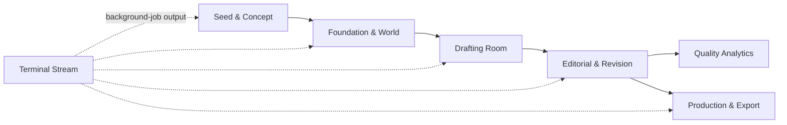
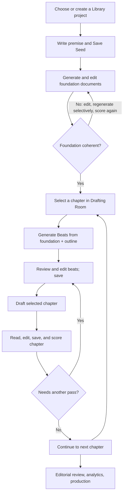
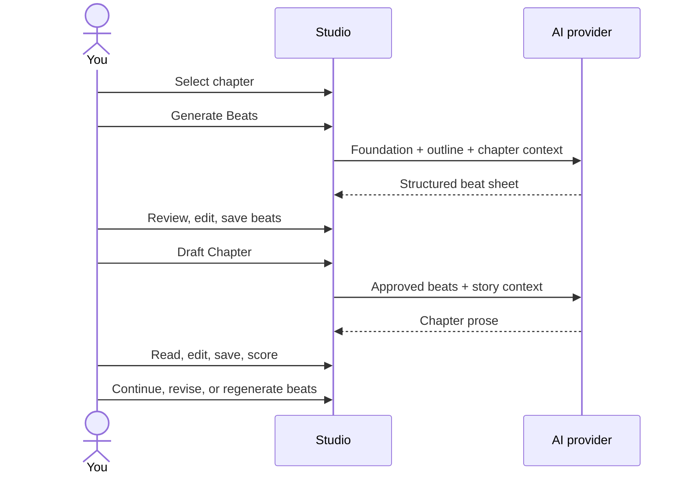

# Autonovel Studio User Manual

This guide explains the current browser-based Studio: how to prepare a project,
build its story foundation, generate chapter beats and prose one chapter at a
time, revise the manuscript, and export available production files. Studio is
an AI-assisted writing workspace; review generated material before treating it
as canon or finished prose.

## Start the Studio

### macOS quick start

From Finder, open `run_autonovel.command`, or from Terminal:

```bash
cd /path/to/autonovel
./run_autonovel.command
```

The launcher starts the local server on `http://localhost:8080` and opens that
address in a browser. Keep the terminal window open while using Studio; it
shows server errors and background-job output. To stop the server, focus that
terminal and press `Control+C`.

The launcher uses the repository's `.venv` when present, otherwise `uv`, then
`python3`. It builds the frontend only when `ui/dist` is missing. For a manual
setup, install the Python dependencies in `pyproject.toml`, install UI
dependencies with `npm --prefix ui install`, build with
`npm --prefix ui run build`, then launch with `PORT=8080 uv run python server.py`.

### API key setup

Copy `.env.example` to `.env` in the repository root and add a key for a
supported text provider, such as `GEMINI_API_KEY` or `ANTHROPIC_API_KEY`.
Never commit `.env` or paste a key into a document. Restart the Studio after
changing environment keys. When running the backend from a different checkout,
set `AUTONOVEL_ENV_FILE` to the absolute path of the intended `.env` before
starting it; this avoids reading keys from the wrong checkout.

Other services (such as illustration or narration providers) are optional and
only needed for those specific production actions. Check `.env.example` for
the current variable names.

## Understand the workspace

The left sidebar switches between pipeline stages. The top bar exposes project
status, language, engine settings, reset, and whole-pipeline actions. Use
**My Library** to select or create a project. Changes belong to the active
project, so check its name before editing or generating.



| Area | What you do there |
|---|---|
| Seed & Concept | Write or riff on the premise and save `seed.txt`. |
| Foundation & World | Generate and edit world, character, outline, canon, and voice planning documents; evaluate foundation quality. |
| Drafting Room | Select a chapter, generate/edit its beats, draft or revise prose, and score the chapter. |
| Editorial & Revision | Inspect manuscript feedback and use available revision tools. |
| Quality Analytics | Review chapter-level quality and progress data when available. |
| Production & Export | Start available export and production actions. |
| Terminal Stream | Follow live output and errors from background tasks. |

## A practical end-to-end workflow



## 1. Create a premise

1. Confirm the active project in the sidebar. Use **My Library** to switch
   projects or create one.
2. Open **Seed & Concept**. Write directly in the premise editor or enter an
   idea in **AI Idea Riffing** and choose the number of variants.
3. Read the candidates critically, select or adapt the premise you want, and
   click **Save Seed**. AI suggestions are not saved as your premise until you
   choose and save one.

## 2. Build and assess the foundation

Open **Foundation & World** and work through the planning documents shown by
the Studio. The main set is `world.md`, `characters.md`, `outline.md`,
`canon.md`, and `voice.md`.

Generate documents in dependency order, then read and edit them before
continuing. The outline supplies the story-wide chapter trajectory; canon
records facts later chapters should not contradict; voice guidance describes
how the prose should sound. Use the foundation scoring action when available
to identify gaps. A score is diagnostic guidance, not a guarantee of story
quality. Keep an eye on **Terminal Stream** for task progress and errors.

## 3. Generate beats and draft one chapter

The Drafting Room supports focused chapter work as well as **Draft All**.
Working chapter by chapter lets you approve the scene plan before spending a
drafting request and helps you catch continuity problems early.

1. Open **Drafting Room** and select a chapter from **Manuscript Chapters**.
2. If no chapter beat sheet exists, choose **Generate Beats**. The model uses
   the foundation documents and the chapter's place in the overall outline to
   propose a structured beat sheet. This action may require a configured
   provider API key.
3. Review the generated beats in the chapter's beat panel. Edit them to
   correct motivation, causality, pacing, or canon, then save. Beats are a
   working plan, not immutable instructions.
4. Choose **Draft Chapter** for the selected chapter. If you draft without
   beats, the system can use the outline and context available to it; adding
   beats first gives you more control over the chapter's shape.
5. Watch **Terminal Stream** while the job runs. When it finishes, return to
   the selected chapter and review the prose in the editor. Save your own
   changes explicitly with **Save Prose Changes**.
6. Use **Score Chapter** to get feedback. Decide whether to edit, revise from
   beats, regenerate beats, or continue to the next chapter. Re-drafting can
   replace existing work; read the confirmation and preserve a copy if needed.

Use **Draft All** only when you want the pipeline to proceed across the
manuscript without stopping for chapter-by-chapter approval. Long AI jobs can
take time and can incur provider charges.

### Chapter iteration loop



## 4. Revise and evaluate

Use **Editorial & Revision** to inspect the available editing and review tools.
Use **Quality Analytics** to compare chapter results and manuscript progress
where data is available. Scores and model-generated critique are signals for
your judgment: verify factual, cultural, linguistic, and continuity claims in
the actual manuscript. Update canon or the outline when a deliberate story
change should carry forward.

## 5. Produce and export

Open **Production & Export** and select the action you need. Some outputs need
optional service credentials and local tooling; the action and its terminal
output indicate what is available and whether it completed. Inspect generated
files before sharing or publishing them.

## Language, settings, and safeguards

- Use the language control in the top bar to switch the Studio interface
  between English and Arabic. The project generation language is configured in
  the engine/project settings; changing interface language alone may not
  translate existing documents.
- **Engine Settings** controls available model and writing options. Model names
  and controls depend on this project version and provider configuration.
- Use **New Novel / Reset** carefully. It clears project state/drafts as
  described by the confirmation dialog. Back up files or create a separate
  project before a reset.
- The Studio binds to loopback (`127.0.0.1`) by default. Do not expose it to a
  network without adding appropriate authentication and CSRF protections;
  CORS settings alone are not access control.
- Do not treat AI output as verified fact. Keep your own copies of valuable
  drafts and review generated material before publication.

## Troubleshooting

| Symptom | What to check |
|---|---|
| Browser says the page cannot be reached | Confirm the launcher/server is still running. Open the exact port printed in the terminal (the launcher uses `8080`; manual startup uses the configured `PORT`, otherwise `8000`). |
| “Neither GEMINI_API_KEY nor ANTHROPIC_API_KEY is set” | Confirm the key variable spelling and `.env` path. Restart Studio after editing `.env`; with a separate checkout, set `AUTONOVEL_ENV_FILE` to the intended file. Never paste the secret into logs or support messages. |
| A background action failed | Open **Terminal Stream** and inspect the complete error. Check the API key/provider, required input documents, and selected project before retrying. |
| A score or result is not visible yet | Wait for the job to finish, refresh the relevant Studio state, and reopen the chapter or analytics view. If still missing, inspect the terminal output for a save/API error. |
| The wrong novel appears | Check the active project label and select the intended book using **My Library**. |
| The frontend appears stale after UI updates | Stop the server, rebuild with `npm --prefix ui run build`, then restart it. |

For command-line usage and the technical pipeline specification, see
[`WORKFLOW.md`](WORKFLOW.md) and [`PIPELINE.md`](PIPELINE.md).
